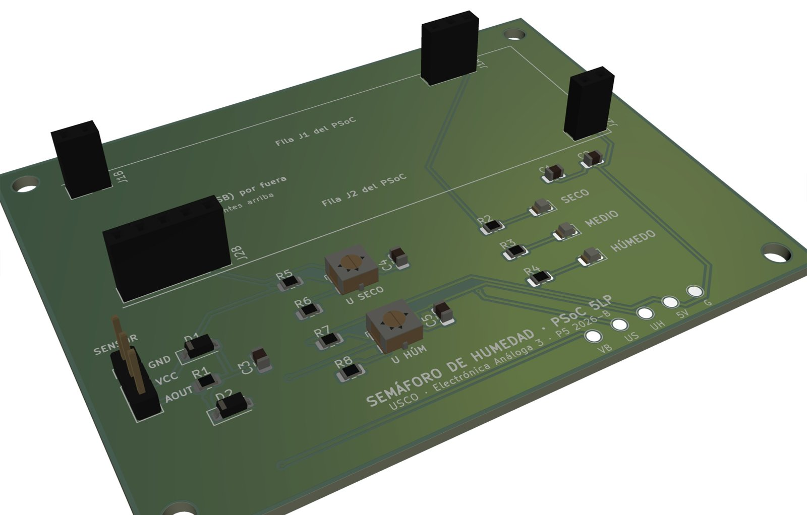

# Semáforo de humedad del suelo para PSoC 5LP

Tarjeta de expansión para la **PSoC 5LP (CY8CKIT-059)** que clasifica la humedad del suelo en **seco, semihúmedo o húmedo** con un semáforo de LED. La decisión es **100 % analógica**: un seguidor de voltaje, dos comparadores y una compuerta NOR internos de la PSoC comparan la señal de un sensor capacitivo con dos umbrales que se ajustan con trimmers. La CPU solo arranca los bloques y reporta el estado por USB.

Proyecto del curso **Electrónica Análoga 3**, Universidad Surcolombiana (Neiva), 2026-B. Docente: Ing. Julián Adolfo Ramírez Gutiérrez.



**[Bitácora del proyecto](https://serrato5.github.io/semaforo-humedad-psoc5lp/)**: el recorrido completo, con los errores y las decisiones · **[Video del funcionamiento](https://youtu.be/htcd85bEVA8)**

## Equipo

| Integrante |
|---|
| Sebastián Serrato Ramírez · [LinkedIn](https://www.linkedin.com/in/sebaserrato) · [GitHub](https://github.com/Serrato5) |
| Juan Esteban Velásquez Perdomo |
| Keren Jireth Ramírez Rivera |
| Juan Diego Morales Parra |
| Juan Diego Valderrama Rodríguez |

## Resultados

| Prueba | Resultado |
|---|---|
| Suelo seco (Vbuf) | 2,68 V → LED rojo |
| Suelo húmedo (Vbuf) | 2,09 V → LED verde |
| Efecto de carga del multímetro en la salida del sensor | 2,68 V → 2,50 V (justifica el seguidor) |
| Protección con 12 V en el cable (simulación) | 5,64 V con 1N4007 · 5,19 V con Schottky B5819W |
| PCB por CNC (P4) | Separación mínima 0,84 mm (regla 0,6 mm) |
| PCB industrial (P5) | ERC 0 · DRC 0 · paridad esquemático–PCB 0 |
| Cotización JLCPCB (2 tarjetas ensambladas) | USD 19,03 + conectores USD 0,72 = **USD 19,75** (límite USD 20) |

## Cómo evolucionó

0. **Exploración (P1)**: generador de señales con WaveDAC8 (f = fs/N, error 0,4–2,2 %); de ahí salió la lección del efecto de carga del DAC que llevó al seguidor.
1. **ADC y software**: descartado, porque el curso exigía procesamiento analógico.
2. **Bloques analógicos con umbrales fijos en VDAC (firmware v1)**: había que reprogramar para cambiar un rango.
3. **Trimmers en la tarjeta (firmware v2)**: los rangos se ajustan sin computador, como pidió el usuario entrevistado.
4. **PCB de una cara fresada en CNC (P4)**.
5. **Tarjeta SMD de dos capas para ensamble en JLCPCB (P5)**, con socket parcial para enchufar la PSoC sin soldarla.

## Contenido del repositorio

```
firmware/
  v1_vdac/main.c          umbrales fijos con dos VDAC8
  v2_trimmers/main.c      versión final: umbrales por trimmer (P3[2], P3[3])
hardware/
  p4_pcb_cnc/             PCB de una cara: G-code para Mach3, Gerber, Excellon, KiCad y scripts
  p5_pcba/
    kicad/                proyecto KiCad 10 (esquemático, PCB, reportes ERC/DRC)
    fabricacion/          Gerber (zip), BOM y CPL en formato JLCPCB
    scripts/              generación del esquemático y la PCB, autorruteo y archivos de fabricación
    esquematico_P5.pdf
simulacion/               simulación en Python del semáforo y de la protección de entrada
documentos/               informe del P1 (WaveDAC8), expedientes técnicos del P4 y del P5, y el póster (80 × 160 cm)
docs/                     bitácora publicada con GitHub Pages
```

### Conexiones con la PSoC

| Señal | Pin del kit |
|---|---|
| Sensor protegido (SENS) | P3[0] |
| Salida del seguidor (Vbuf) | P3[1] |
| Umbral seco / húmedo | P3[2] / P3[3] |
| LED rojo / amarillo / verde | P2[3] / P2[4] / P2[5] |
| UART al PC (115200 baudios) | P12[7] |

### Regenerar la PCB del P5

Los scripts de `hardware/p5_pcba/scripts` usan KiCad 10 (`kicad-cli` y el módulo `pcbnew`) y Freerouting 2.5:

```sh
ROW=20.32 FLIP=0 sh build.sh   # esquemático, ERC, PCB, autorruteo, planos de GND y DRC
sh fab.sh                      # Gerber, taladros, BOM y CPL para JLCPCB
```

`ROW` es la distancia entre las filas J1 y J2 del kit. **El valor de 20,32 mm es una estimación hecha sobre una foto; hay que medirlo con calibrador antes de fabricar.**
